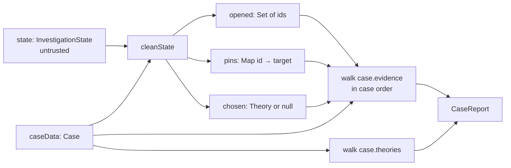

# Design Document: case-report

## Overview

`buildCaseReport(caseData, state)` turns a case and the user's investigation state into a `CaseReport`: plain data that a later verdict screen renders. It is one pure function in `src/lib/case-report.ts`, with its types beside it. Nothing in `src/types/case.ts`, the investigation reducer or the case content changes.

### Key decisions

1. **Clean the state once, then derive everything from the case.** The state is untrusted: it comes from localStorage and may be stale or corrupted. The function first reduces it to three clean values (a set of opened ids, a map of valid pins, an optional chosen theory). Every list in the report is then built by walking `case.evidence` or `case.theories`, never the state. This one choice gives the ordering rule (9.5), the "only ids from the case" rule (9.4) and the "ignore unknown ids" rule (9.2) together.
2. **Total by construction, with one backstop.** Cleaning checks every value's type before using it. As a backstop, the cleaning step is wrapped in `try/catch` and falls back to an empty investigation. That covers values a type check cannot see, such as a getter that throws.
3. **Lookups use `Map` and `Set`, never plain objects.** An evidence id such as `constructor` or `__proto__` can never match something on `Object.prototype`.
4. **The report describes historians' reading, never the user.** `agree`, `disagree` and `no-link` say how historians read a file against the user's choice. There are no counts, scores or booleans like `correct` (8.1).
5. **Status stays hidden for files never opened** (5.5). A missed file shows its title and whether it supports or weakens the verdict, not whether it is Record, Disputed or Legend.

## Architecture



Only `cleanState` touches the state. Everything after it reads clean values and the case.

## Components and Interfaces

### `src/lib/case-report.ts`

```ts
import type { Case, EvidenceStatus, InvestigationState, PinTarget, TheoryStanding } from '@/types/case';

/** How historians read a pinned file against the user's choice (Requirement 2). */
export type HistoriansReading = 'agree' | 'disagree' | 'no-link';

/** How an unopened file bears on the chosen theory (Requirement 5). */
export type VerdictLink = 'supports' | 'weakens';

export interface ReportVerdict {
  theoryId: string;
  title: string;
  claim: string;
  standing: TheoryStanding;
  standingReason: string;
}

export interface PinReading {
  evidenceId: string;
  title: string;
  status: EvidenceStatus;
  /** The theory id the user chose, or "none". */
  target: PinTarget;
  reading: HistoriansReading;
  /** The evidence's reading.note. */
  note: string;
}

export interface ReliedOnEntry {
  evidenceId: string;
  title: string;
  status: EvidenceStatus;
  reading: HistoriansReading;
}

export interface AgainstVerdictEntry {
  evidenceId: string;
  title: string;
  status: EvidenceStatus;
  note: string;
}

/** No status: it is earned by opening the file. */
export interface NeverOpenedEntry {
  evidenceId: string;
  title: string;
  link: VerdictLink;
}

export interface LegendTrustedEntry {
  evidenceId: string;
  title: string;
  /** The theory the user pinned this legend to. */
  theoryId: string;
  origin: string;
}

export interface TheoryStandingEntry {
  theoryId: string;
  title: string;
  standing: TheoryStanding;
  standingReason: string;
}

export interface CaseReport {
  verdict: ReportVerdict | null;
  pins: PinReading[];
  reliedOn: ReliedOnEntry[];
  againstVerdict: AgainstVerdictEntry[];
  neverOpened: NeverOpenedEntry[];
  legendsTrusted: LegendTrustedEntry[];
  historiansStand: { theories: TheoryStandingEntry[]; summary: string[] };
}

export function buildCaseReport(caseData: Case, state: InvestigationState): CaseReport;
```

The parameter is typed `InvestigationState` so callers get type checking. At runtime the function treats it as `unknown` (Requirement 9.1). Tests pass malformed values with `as unknown as InvestigationState`.

### Step 1: `cleanState(caseData, state)`

Not exported. It returns `{ opened: Set<string>, pins: Map<string, PinTarget>, chosen: Theory | null }`.

```
evidenceIds = Set of case.evidence ids
theoriesById = Map of case.theories by id

try:
  if state is not a non-null object: return empty
  opened  = for each item of state.opened (only if Array.isArray):
              keep it if typeof item === 'string' and evidenceIds has it        (9.2, 9.3: a Set drops duplicates)
  pins    = only if state.pins is a non-null object and not an array:
              for each [key, value] of Object.entries(state.pins):
                keep it if evidenceIds has key
                          and typeof value === 'string'
                          and (value === 'none' or theoriesById has value)     (Valid_Pin)
  chosen  = typeof state.verdict === 'string' ? theoriesById.get(state.verdict) ?? null : null
catch:
  return empty                                                                 (decision 2)
```

`Object.entries` reads only own enumerable string keys, so inherited properties never become pins.

### Step 2: `historiansReading(evidence, target)`

| Target | Rule | Result | Criterion |
| --- | --- | --- | --- |
| theory id in `reading.supports` | checked first | `agree` | 2.3 |
| theory id in `reading.weakens` only | | `disagree` | 2.4 |
| theory id in neither | | `no-link` | 2.5 |
| `"none"`, `reading.supports` empty | | `agree` | 2.6 |
| `"none"`, `reading.supports` not empty | | `disagree` | 2.7 |

Checking `supports` before `weakens` makes `agree` win when a theory is in both lists (note on 2.3).

`verdictLink(evidence, theoryId)` follows the same precedence: `supports` if the id is in `reading.supports`, otherwise `weakens` if it is in `reading.weakens`, otherwise no link.

### Step 3: one walk over `case.evidence`

Every list is filled in this single loop, so all of them come out in Case_Order (9.5).

```
for each evidence of case.evidence:
  target = pins.get(evidence.id)
  isOpen = opened.has(evidence.id)

  if target exists:
    reading = historiansReading(evidence, target)
    push to pins: { id, title, status, target, reading, note }                 (2.1, 2.2)
    if chosen and target === chosen.id:  push to reliedOn                      (3.1)
    if evidence.status === 'legend' and target !== 'none':
      push to legendsTrusted: { id, title, theoryId: target, origin }          (6.1, 6.2)

  if chosen:
    if isOpen and evidence.reading.weakens includes chosen.id:
      push to againstVerdict                                                   (4.1)
    if not isOpen and verdictLink(evidence, chosen.id) exists:
      push to neverOpened: { id, title, link }                                 (5.1, 5.3)
```

`againstVerdict` needs `isOpen` and `neverOpened` needs `not isOpen`. A file can therefore never be in both, and nothing in `neverOpened` is ever in the Opened_Set (5.4).

`reliedOn` and `legendsTrusted` follow the pins, not `opened`. A file pinned without being opened still counts. The reducer allows that, and the report mirrors the state as it is.

### Step 4: verdict and historians

- `verdict`: `chosen` copied into a `ReportVerdict`, or `null` (1.1, 1.2).
- `historiansStand.theories`: `case.theories` mapped in order (7.1).
- `historiansStand.summary`: a copy of `case.historiansSummary` (7.2). It is a copy, so the report never shares an array with the case.
- Steps 3 and 4 never depend on `chosen` for pins, legends or historians (6.3, 7.3).

### Purity (9.6)

The function only reads its inputs. Every array and object in the report is new. Nothing reads the clock, random numbers, storage or globals. Equal inputs therefore give equal reports.

## Data Models

The report types above are the only new types. Their relation to the case:

| Report field | Comes from | Ids it can contain |
| --- | --- | --- |
| `verdict` | `case.theories`, chosen by `state.verdict` | one theory id from the case |
| `pins`, `reliedOn` | `case.evidence`, filtered by valid pins | evidence ids from the case; a theory id from the case, or `"none"` |
| `againstVerdict`, `neverOpened` | `case.evidence`, filtered against `chosen` | evidence ids from the case |
| `legendsTrusted` | `case.evidence` with status `legend`, filtered by pins | evidence ids and theory ids from the case |
| `historiansStand` | `case.theories`, `case.historiansSummary` | theory ids from the case |

No id is ever copied out of `reading.supports` or `reading.weakens`, so 9.4 holds even if a case's readings named an unknown theory.

### Worked example: the Mary Celeste

From the current case data:

| Theory | Files that support it | Files that weaken it |
| --- | --- | --- |
| `t-sinking` | lifeboat, instruments, last-note, water, pump, belongings, course-change | none |
| `t-explosion` | lifeboat, instruments, belongings, empty-barrels, hatches | none |
| `t-mutiny` | lifeboat | cargo-food, findings, sword, bow-marks |
| `t-salvage-murder` | none | findings |
| `t-fraud` | none | findings, bow-marks |

State: opened `[e-water, e-lifeboat]`; pins `{ e-sword: t-mutiny, e-legend-breakfast: t-sinking, e-lifeboat: t-sinking, e-findings: none }`; verdict `t-sinking`. Report:

- **verdict:** `t-sinking`, leading, with its reason.
- **pins**, in case order: e-lifeboat → `agree`; e-findings → `none`, `agree` (it supports no theory); e-sword → `t-mutiny`, `disagree`; e-legend-breakfast → `t-sinking`, `no-link`.
- **reliedOn:** e-lifeboat, e-legend-breakfast.
- **againstVerdict:** empty, because no file weakens `t-sinking`.
- **neverOpened:** instruments, last-note, pump, belongings, course-change, all `supports`. e-water and e-lifeboat are opened, so they are not listed.
- **legendsTrusted:** e-legend-breakfast, pinned to `t-sinking`, with its origin.

## Correctness Properties

Each property is a fast-check property in `src/lib/__tests__/case-report.property.test.ts`.

### Property 1: Never throws
For any generated case and any state, including `fc.anything()` in place of the whole state and in place of each of its fields, `buildCaseReport` returns a value with all seven parts and does not throw. **Validates 9.1, 10.1.**

### Property 2: Every pinned legend is listed
For any case and valid-ish state, the evidence ids in `legendsTrusted` are exactly the legend files that have a Valid_Pin to a theory (not `"none"`), each with the theory it was pinned to. **Validates 6.1, 6.2, 10.2.**

### Property 3: Opened and never opened do not overlap
For any case and state, no id in `neverOpened` is in the Opened_Set. **Validates 5.4, 10.3.**

### Property 4: Every id belongs to the case
For any case and state, every evidence id in the report is in `case.evidence`, and every theory id (the verdict, pin targets other than `"none"`, `legendsTrusted.theoryId`, `historiansStand`) is in `case.theories`. The states mix known and unknown ids. **Validates 9.2, 9.4, 10.4.**

### Property 5: Deterministic and non-mutating
For any case and state, two calls give `toStrictEqual` reports, and the case and state are `toStrictEqual` to `structuredClone` copies taken before the call. **Validates 9.6, 10.5.**

### Property 6: Order of the state does not matter
For any case and state, shuffling `opened`, adding duplicates to it, and rebuilding `pins` with its keys in another order gives a `toStrictEqual` report. **Validates 9.3, 9.5.**

### Property 7: The reading rules
For any case and valid-ish state, every Pin_Reading's `reading` matches the table in Step 2, worked out independently in the test from the evidence's `supports` and `weakens`. **Validates 2.3 to 2.7.**

## Error Handling

There are no errors to report. The function always returns a report. Bad input is handled by leaving it out:

| Input | Result |
| --- | --- |
| `state` not an object, or `null` | an empty investigation: no pins, no verdict, historians still shown |
| `opened` not an array, or holding non-strings or unknown ids | those entries ignored |
| `pins` not an object, or an array; a key not in the case; a value not `"none"` and not a known theory | those entries ignored |
| `verdict` not a string, or not a known theory | `verdict: null`; reliedOn, againstVerdict and neverOpened empty |
| anything else that throws while reading the state | caught; treated as an empty investigation |

The case itself is trusted: it type-checks and the registry test runs `validateCase` on it.

## Testing Strategy

Vitest 5.1.0 and fast-check 4.10.2, checked against current docs with Context7. Both test files run in Vitest's default Node environment: no DOM is needed.

### Property tests: `src/lib/__tests__/case-report.property.test.ts`

Generators, following `src/app/__tests__/InvestigationProvider.property.test.ts`:

- **Ids:** prefixed suffixes from `fc.stringMatching(/^[a-z0-9]{1,8}$/)`, built once. Case ids start with `e-` and `t-`. Unknown ids start with `x-` and `z-`, so they can never collide with case ids or with `"none"`.
- **Case:** `fc.uniqueArray` of 1 to 12 evidence ids and 1 to 5 theory ids. Each evidence item gets a status from `fc.constantFrom('record', 'disputed', 'legend')`, plus `reading.supports` and `reading.weakens` from `fc.subarray(theoryIds)`. The two lists may overlap, to exercise the `agree`-wins rule. Legend items get an `origin`, disputed items a `dispute`.
- **Valid-ish state:** `opened` is an `fc.array` of `fc.oneof(fc.constantFrom(...evidenceIds), unknownEvidenceId)`, so it has duplicates and unknown ids. `pins` is an `fc.dictionary` whose keys mix case and unknown evidence ids, and whose values mix theory ids, `"none"` and unknown theory ids. `verdict` comes from `fc.option(fc.oneof(fc.constantFrom(...theoryIds), unknownTheoryId))`.
- **Garbage state:** `fc.anything()` for the whole state, and an `fc.record` with `fc.anything()` for each of `opened`, `pins` and `verdict`.

`fc.assert(fc.property(...))` with the default 100 runs per property, as the existing property tests use. Cases are generated with `.chain` so the state draws from the case's own ids.

### Unit tests: `src/lib/__tests__/case-report.test.ts`

Against the real Mary Celeste case:

- The worked example above, part by part.
- A `t-mutiny` verdict: `againstVerdict` lists e-cargo-food and e-sword when both are opened. `neverOpened` lists e-lifeboat (`supports`) and e-findings and e-bow-marks (`weakens`).
- No verdict (`null`, and an unknown id): verdict `null`; reliedOn, againstVerdict and neverOpened empty; pins, legendsTrusted and historiansStand still filled.
- A legend pinned to `"none"` is not in `legendsTrusted`.
- `historiansStand` lists all five theories in case order and the three summary paragraphs unchanged.
- `neverOpened` entries have no `status` key.
- The report has no number-valued or boolean-valued field anywhere (8.1), checked by walking the whole report.

### Build checks

Each task ends with `npm test`, `npm run build` and `npm run lint`, all passing, then a short report and a `[kiro]` commit.
