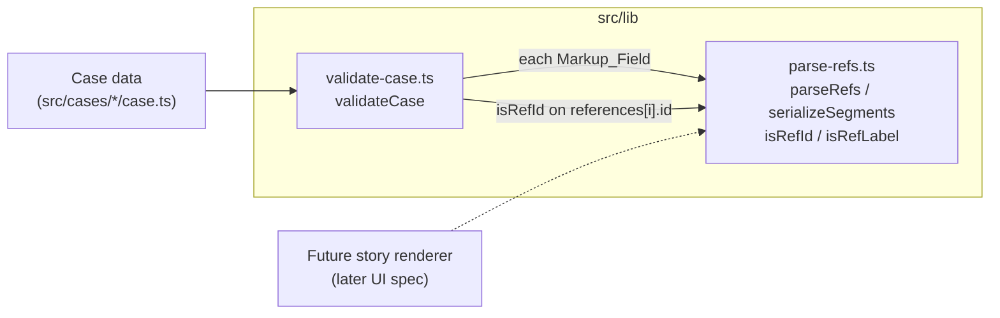

# Design Document: story-engine

## Overview

This feature adds the logic layer for portal markup (`{{ref:<id>|<label>}}`) and nothing else. It has three parts:

1. `src/lib/parse-refs.ts`: a pure, total, lossless parser that splits a string into text and ref segments, and a serializer that joins them back.
2. An extension of `validateCase` in `src/lib/validate-case.ts` that runs the parser over every Markup_Field, rejects `{{` in every Plain_Field, and checks the format of every reference id.
3. Property-based and unit tests (Vitest 5.1.0, fast-check 4.10.2, both checked in `node_modules`).

No UI, no change to `src/types/case.ts`, no change to case content.

### Key decisions

| Decision | Choice | Why |
| --- | --- | --- |
| How a ref is recognised | A hand-written matcher at each `{{` position, no regex with shared `lastIndex` | Keeps the parser free of module-level mutable state (1.12), easy to argue it never throws, linear time |
| Malformed_Markup counting | Literal: every index `p` inside a Text_Segment where `text[p] === '{'` and `text[p+1] === '{'`, overlapping. `{{{x` gives 2 errors | Matches the glossary ("including overlapping positions") and 4.5 |
| Stray braces (4.13) | Per Text_Segment: if it contains `{{`, only 4.4 applies; otherwise, if it contains `{` or `}`, exactly one stray-brace error | Catches leftover braces around otherwise valid refs without double-reporting `{{` |
| Plain_Field enumeration | Generic recursive walk of the whole `Case`, skipping the exact Field_Locations produced by the Markup_Field enumeration | One source of truth for "markup vs plain"; covers optional and nested fields (`image.alt`, `theme.sounds.stamp`, `dispute.claim`) and any field added to the types later |
| Reference id with `{{` | Both the 4.11 error and the 4.12 error | They report different defects and both requirements apply literally |
| Excerpt length (4.4 and 4.13) | 40 Unicode code points, cut with `for...of`, taken from the field text starting at the offending `{{` or brace | Never splits a surrogate pair. Wording mismatch: 4.4 says "40 characters", 4.13 says "40 code points"; the design uses code points for both |
| Existing generator in `validate-case.property.test.ts` | Add a brace filter to `nonEmptyString()` (allowed by 4.9; listed in the task report). See "Existing test compatibility" | Without it, the existing Property 8 fails on almost every run |

## Architecture



`validateCase` flow after this feature:

```mermaid
flowchart TD
  A[existing structural checks] --> B[existing uniqueness + referential checks<br/>minus the old regex story-body block]
  B --> C[4.12 reference id format]
  C --> D[markupFields: enumerate Markup_Fields]
  D --> E[parseRefs each field<br/>unknown ids + Malformed_Markup<br/>+ stray braces]
  D --> F[set of Markup_Field locations]
  F --> G[walk every string in Case<br/>skip markup locations<br/>4.11 '{{' check]
  E --> H[errors]
  G --> H
```

Both modules are pure. `parse-refs.ts` imports nothing. `validate-case.ts` imports from `@/lib/parse-refs` (7.1).

## Components and Interfaces

### `src/lib/parse-refs.ts`

```ts
export interface TextSegment {
  kind: 'text';
  /** Plain text exactly as written. Always at least 1 character. Also its Raw_Text. */
  text: string;
}

export interface RefSegment {
  kind: 'ref';
  /** A Ref_Id. */
  id: string;
  /** A Ref_Label, whitespace kept as written. */
  label: string;
  /** The full markup, `{{ref:` through `}}`. Always equals `{{ref:${id}|${label}}}`. */
  raw: string;
}

export type Segment = TextSegment | RefSegment;

/** True when s matches ^[a-z0-9]+(-[a-z0-9]+)*$. */
export function isRefId(s: string): boolean;

/** True when s is non-empty, has no '{', '}' or '|', and has a non-whitespace character. */
export function isRefLabel(s: string): boolean;

/** Splits input into segments. Total: never throws, for every string. */
export function parseRefs(input: string): Segment[];

/** Concatenates the Raw_Text of every segment, in order. */
export function serializeSegments(segments: readonly Segment[]): string;
```

`isRefId` uses a non-global, non-sticky regex literal (`/^[a-z0-9]+(?:-[a-z0-9]+)*$/`). `RegExp.prototype.test` reads and writes `lastIndex` only for global or sticky regexes, so this regex holds no state between calls. `isRefLabel` uses `/[{}|]/` and `/\S/`, also non-global. "Whitespace" means JavaScript's `\s` set, which is the same set `String.prototype.trim` removes, so the parser and the existing `trim()`-based checks agree.

#### Scanning algorithm

```ts
const PREFIX = '{{ref:';

function matchRefAt(input: string, p: number): { id: string; label: string; end: number } | null {
  if (!input.startsWith(PREFIX, p)) return null;
  const idStart = p + PREFIX.length;
  let j = idStart;
  while (j < input.length && isIdChar(input.charCodeAt(j))) j++;      // [a-z0-9-]
  if (input[j] !== '|') return null;
  const id = input.slice(idStart, j);
  if (!isRefId(id)) return null;                                        // rejects '', '-a', 'a-', 'a--b'
  const labelStart = j + 1;
  let k = labelStart;
  while (k < input.length && !isLabelStop(input.charCodeAt(k))) k++;   // stop at '{', '}', '|'
  if (input[k] !== '}' || input[k + 1] !== '}') return null;
  const label = input.slice(labelStart, k);
  if (!isRefLabel(label)) return null;                                  // rejects '' and whitespace-only
  return { id, label, end: k + 2 };
}

export function parseRefs(input: string): Segment[] {
  const out: Segment[] = [];
  let textStart = 0;                 // start of pending plain text
  let i = 0;                         // scan cursor
  while (true) {
    const p = input.indexOf('{{', i);
    if (p === -1) break;
    const m = matchRefAt(input, p);
    if (m === null) { i = p + 1; continue; }   // not a ref here: try the next '{{', which may overlap
    if (p > textStart) out.push({ kind: 'text', text: input.slice(textStart, p) });
    out.push({ kind: 'ref', id: m.id, label: m.label, raw: input.slice(p, m.end) });
    textStart = i = m.end;
  }
  if (textStart < input.length) out.push({ kind: 'text', text: input.slice(textStart) });
  return out;
}
```

How this meets each requirement:

- **Left to right, consume then continue (1.4, 1.5).** `indexOf('{{', i)` finds the leftmost candidate. A match moves both cursors past the closing `}}`.
- **Overlap handling (2.9).** On a failed candidate the cursor moves by one, not two, so `{{{ref:a|b}}` fails at 0 and matches at 1, leaving `{` as text.
- **Nested markup (2.8).** In `{{ref:a|b {{ref:c|d}}}}` the label scan from position 0 stops at the inner `{`, so the outer candidate fails. The inner ref matches. The remaining `}}` becomes text.
- **Malformed forms (2.1 to 2.7).** Each fails one specific check in `matchRefAt`: unclosed (no `}}` after the label), missing label (`}` where `|` is required), empty id (`isRefId('')` is false), empty or whitespace label (`isRefLabel`), wrong or uppercase prefix or leading space (`startsWith` fails), invalid id (`isRefId` or stop at a non-id char other than `|`), `|` in label (label scan stops at the second `|`, which is not `}`). Failed characters are never removed; they stay in the pending text range.
- **Text merging (1.9, 1.10).** Text is emitted only when flushing before a ref or at the end, from `textStart`, and only when non-empty. A Text_Segment is therefore always followed by a Ref_Segment or the end, so two Text_Segments are never neighbours.
- **Empty input and input without `{{` (1.7, 1.8).** The loop exits at once. The final flush emits nothing for `''` and one Text_Segment equal to the input otherwise.
- **Ref fields (1.3, 1.11).** `id` passed `isRefId`, `label` passed `isRefLabel`, and `raw` is the exact slice `[p, end)`, which equals `` `{{ref:${id}|${label}}}` `` by construction.

#### Totality (1.2)

`parseRefs` calls only `String.prototype.indexOf`, `startsWith`, `slice`, `charCodeAt`, indexing, and non-global `RegExp.prototype.test`. None of these throws for any string argument and any integer index, including out-of-range indexes (`input[k]` is `undefined`, `charCodeAt` returns `NaN`, both compared safely). There is no recursion, so no stack overflow. The loop terminates because `i` strictly increases on every iteration: `indexOf` returns `p >= i`, a miss sets `i = p + 1`, and a hit sets `i = m.end > p`. Since `i` is bounded by the input length, `indexOf` eventually returns `-1`. Lone surrogates are ordinary UTF-16 code units here; every slice boundary is either 0, the input length, or next to an ASCII `{` or `}`, so surrogate pairs are never split.

#### Losslessness (3.1, 3.2, 3.3)

Invariant at the top of each loop iteration: `serializeSegments(out) === input.slice(0, textStart)`.

- Initially `out = []` and `textStart = 0`, so both sides are `''`.
- On a miss, `out` and `textStart` are unchanged.
- On a hit, the pushed text is `input.slice(textStart, p)` and the pushed raw is `input.slice(p, m.end)`, so the serialization grows to `input.slice(0, m.end)`, and `textStart` becomes `m.end`.
- After the loop, the final flush appends `input.slice(textStart)`.

So `serializeSegments(parseRefs(s)) === s` for every `s`. Because `parseRefs` is deterministic, `parseRefs(serializeSegments(parseRefs(s)))` is `parseRefs(s)`, which gives 3.3.

#### Running time

Each `{{` position is tried once. A candidate that passes `startsWith` scans forward only until the next `{`, `}` or `|`, and the next candidate after it starts at a `{` no earlier than that stop. Scanned ranges therefore do not overlap, and the parser is linear in the input length.

#### `serializeSegments`

```ts
export function serializeSegments(segments: readonly Segment[]): string {
  let s = '';
  for (const seg of segments) s += seg.kind === 'text' ? seg.text : seg.raw;
  return s;
}
```

### `src/lib/validate-case.ts` extension

The existing structural, uniqueness and referential checks stay as they are (4.9). The block under `// Validate story reference markup {{ref:id|label}} (7.22, 7.23)` (the `referenceMarkupRegex` loop) is deleted and replaced (4.7). Three new checks are appended in this order. Tests use `toContain`, so order is not part of the contract.

#### Check A: reference id format (4.12)

The current validator checks only that reference ids are unique (`Field references: duplicate ID ...`). It does not check that they are non-empty or that they follow any format. This check is new.

```ts
caseData.references.forEach((ref, i) => {
  if (!isRefId(ref.id)) errors.push(`Field references[${i}].id: '${ref.id}' is not a valid reference ID`);
});
```

Guarded by `Array.isArray(caseData.references)` like the existing code.

#### Check B: Markup_Fields (4.1 to 4.7)

```ts
interface MarkupField { location: string; text: string }

function markupFields(c: Case): MarkupField[]
```

It returns, in this order, with zero-based indexes, and only for values that are strings:

- `story[i].body[j]` for every body string
- `story[i].hook` when `typeof hook === 'string'`
- `evidence[i].detail[j]` for every detail string
- `references[i].profile[j]` for every profile string

Every array access is guarded with `Array.isArray`, matching the existing style, so a malformed case cannot make the validator throw.

For each field, the validator parses once and walks the segments with a running offset (`offset += raw length`):

- **Ref_Segment** whose `id` is not in the set of `references[].id`: push `Field <location>: reference ID '<id>' not found in references` (4.2). One error per occurrence (4.5).
- **Text_Segment**: for every index `p` with `text[p] === '{' && text[p + 1] === '{'` (overlapping, see Key decisions), classify using `rest = field.slice(offset + p)`:
  - If `rest` matches `/^\{\{ref:[a-z0-9]+(?:-[a-z0-9]+)*\|\s*\}\}/` (a Ref_Id, then a label that is empty or only whitespace): push `Field <location>: Invalid reference markup - label cannot be empty` (4.3).
  - Otherwise: push `Field <location>: Invalid reference markup near '<excerpt>'`, where `<excerpt>` is the first 40 code points of `rest` (4.4).
- **Text_Segment, stray braces (4.13)**: if the text does not contain `{{` and contains `{` or `}`, let `b` be the index of the first `{` or `}` in it and push exactly one `Field <location>: Stray brace near '<excerpt>'`, where `<excerpt>` is the first 40 code points of `field.slice(offset + b)`. A Text_Segment that contains `{{` gets no stray-brace error, even if it also holds a lone `}`.

The two messages are exactly the strings the old regex check produced for unknown ids and empty labels, so the old unit-test assertions still match.

Why a malformed `{{` is always inside a Text_Segment: a Ref_Segment's raw text contains exactly one `{{` (its start), because a label cannot contain `{`. Any other `{{` in the field was not consumed, so it lies in text. A `{{` whose first `{` ends a Text_Segment and whose second `{` starts a Ref_Segment (the `{{{ref:a|b}}` case) is not entirely inside a Text_Segment and is not reported, as the glossary defines.

Excerpt helper:

```ts
function excerpt(s: string, max = 40): string {
  let out = '';
  let n = 0;
  for (const cp of s) { if (n++ === max) break; out += cp; }
  return out;
}
```

When every Markup_Field has only known ids and no `{` or `}` in any Text_Segment, no markup error is produced (4.6).

#### Worked examples

Traced through `parseRefs` above. Each input is the whole field at location `L`, and `a` and `c` are known reference ids.

| Input | Segments | Exact error list |
| --- | --- | --- |
| `{{{ref:a\|b}}` | Candidate at 0 fails (`{{{ref` is not `{{ref:`); candidate at 1 matches. `text "{"`, `ref a` | `Field L: Stray brace near '{{{ref:a\|b}}'` |
| `{{ref:a\|b}}}` | Candidate at 0 matches, ending at 11. `ref a`, `text "}"` | `Field L: Stray brace near '}'` |
| `{{ref:a\|b {{ref:c\|d}}}}` | Candidate at 0 fails (label scan stops at the `{` at 10); position 1 is not `{{`; candidate at 10 matches, ending at 21. `text "{{ref:a\|b "`, `ref c`, `text "}}"` | `Field L: Invalid reference markup near '{{ref:a\|b {{ref:c\|d}}}}'` (one `{{` in the first text, at offset 0, so literal counting gives one error; it contains `{{`, so no stray error) and `Field L: Stray brace near '}}'` |
| `{{{x` | No match. `text "{{{x"` | `Field L: Invalid reference markup near '{{{x'` and `Field L: Invalid reference markup near '{{x'` (two overlapping `{{`; no stray error) |

The first example's `{{` at positions 0 and 1 is not entirely inside a Text_Segment, so it is not Malformed_Markup and only the stray-brace check reports it.

#### Check C: `{{` in Plain_Fields (4.11)

```ts
function collectPlainMarkupErrors(value: unknown, path: string, skip: Set<string>, seen: WeakSet<object>, errors: string[]): void
```

- `skip` is `new Set(markupFields(caseData).map(f => f.location))`, so the walk and Check B use exactly the same definition of a Markup_Field.
- **String:** if `!skip.has(path) && value.includes('{{')`, push `Field <path>: portal markup is not allowed in this field`. One error per Plain_Field, however many `{{` it holds.
- **Array:** recurse into each item with path `` `${path}[${i}]` ``.
- **Plain object:** recurse into each own enumerable key in `Object.keys` order with path `path === '' ? key : `${path}.${key}``.
- **Anything else** (numbers, booleans, `undefined`, `null`): ignored.
- `seen` guards against cycles. `Case` values are trees, so this never fires on real data, but it keeps the validator total.

Start: `collectPlainMarkupErrors(caseData, '', skip, new WeakSet(), errors)`.

The walk visits every string the `Case` type can hold, for example `id`, `title`, `teaser`, `centralQuestion`, `legendIntro.lines[j]`, `legendIntro.stamp`, `legendIntro.debunk`, `story[i].id`, `story[i].kicker`, `story[i].heading`, `fork.prompt`, `theories[i].*`, `evidence[i].id`, `evidence[i].title`, `evidence[i].sources[k]`, `evidence[i].reading.supports[k]`, `evidence[i].reading.weakens[k]`, `evidence[i].reading.note`, `evidence[i].dispute.claim`, `evidence[i].origin`, `evidence[i].image.src`, `sources[i].*`, `references[i].id`, `references[i].label`, `references[i].image.alt`, `references[i].sources[k]`, `historiansSummary[j]`, `theme.id`, `theme.ambientAudio`, `theme.sounds.<name>`. Object keys are not checked; the only free-form keys in `Case` are `theme.sounds` names, which the type restricts to fixed words.

Path examples: `title`, `theories[0].claim`, `story[1].heading`, `evidence[2].dispute.claim`, matching the Field_Path notation.

**Alternative considered:** an explicit per-type list of Plain_Fields. Rejected because it must be kept in step with `src/types/case.ts` by hand, and a missed optional field (`image.credit`, `theme.sounds.close`) would silently let raw markup reach the reader.

#### Interaction of 4.11 and 4.12

`references[i].id` is a Plain_Field. A reference id such as `a{{b` fails `isRefId` and contains `{{`, so it gets both `Field references[i].id: 'a{{b' is not a valid reference ID` and `Field references[i].id: portal markup is not allowed in this field`. Decision: emit both, no de-duplication. Each requirement is stated unconditionally, and the messages describe different problems.

#### Purity (4.8)

The new code reads only its `Case` argument and local variables. Classification regexes are non-global. `WeakSet`, `Set` and the `errors` array are created per call.

### Existing test compatibility (4.9, 4.10)

#### Unit tests in `src/lib/__tests__/validate-case.test.ts`

Assertions that check old story-body ref messages:

| Line | Test | Assertion | Needs update? |
| --- | --- | --- | --- |
| 845 | detects invalid reference ID in story markup | `Field story[0].body[0]: reference ID 'invalid-ref' not found in references` | No. Same text as 4.2 |
| 867 | accepts valid reference ID in story markup | `toEqual([])` with `{{ref:ref1|John Doe}}`, `ref1` is a Ref_Id | No |
| 889 | detects empty label in story reference markup (`{{ref:ref1|}}`) | `... Invalid reference markup - label cannot be empty` | No. Classified as the 4.3 form |
| 911 | detects whitespace-only label (`{{ref:ref1|   }}`) | same message | No. `\s*` matches |
| 933, 934 | detects multiple invalid references in single paragraph | two unknown-id messages | No |
| 962 | detects invalid references across multiple story sections | `Field story[1].body[0]: reference ID 'invalid-ref' ...` | No |
| 990 | accepts multiple valid references across story | `toEqual([])`, ids `ref1`, `ref2` | No |
| 1023 | collects all referential integrity errors together | `errors.length >= 4` plus `toContain` | No |

Other checks on the fixtures: all 9 `{{` occurrences in the file are in `story[].body`, so no Plain_Field holds `{{`. No fixture string has a `{` or `}` outside ref markup, and the empty-label fixtures (`{{ref:ref1|}}`, `{{ref:ref1|   }}`) leave a Text_Segment that contains `{{`, so 4.13 adds no error. Every reference id used is `ref1` or `ref2`, both Ref_Ids. Every `toEqual([])` test therefore still gets `[]`. Conclusion: no existing unit assertion needs to change, and the task report will list none.

#### Property tests in `src/lib/__tests__/validate-case.property.test.ts`

- Properties 9 to 26 assert `errors.some(...)`. Extra errors cannot make them fail. Property 15 appends ` {{ref:non-existent-ref-abc|Invalid Reference}}` and checks for an error containing `story`, `references` and the id; the new message `Field story[0].body[n]: reference ID 'non-existent-ref-abc' not found in references` satisfies it. Property 12 uses reference ids `ref-1` and `ref-2`, both Ref_Ids.
- `validCaseArbitrary` sets `references: []`, so 4.12 never fires there.
- **Property 8 (`Validator Accepts Valid Cases`) would fail without a generator change.** Its `nonEmptyString()` is `fc.string({ minLength: 1 })` filtered on `trim()`. In fast-check 4 the default unit is `'grapheme-ascii'` (printable ASCII), which includes `{`. These strings fill both Plain_Fields (ids, titles, claims, headings, notes, legend lines, summaries) and Markup_Fields (`story[i].body`, `hook`, `evidence[i].detail`). Measured locally with a throwaway probe (2,000 sampled cases, file deleted afterwards): a generated case holds about 225 strings, 8.9% of cases contain `{{` somewhere (4.7% in a Plain_Field, 4.4% in a Markup_Field). With 100 runs and a random seed each time, Property 8 fails with probability about `1 - 0.911^100 ≈ 0.9999`. This is close to certain failure, not a rare flake. Every such `{{` is a genuine error under 4.4 or 4.11, so the validator is right and the generator's notion of "valid case" is out of date.
- **4.13 makes a `{{`-only filter insufficient.** The same generator fills `story[i].body`, `story[i].hook` and `evidence[i].detail`, and a single `{` or `}` there is now a stray-brace error. Measured with `fc.sample` (20,000 strings): 13.6% of strings from `nonEmptyString()` filtered with `!s.includes('{{')` still contain `{` or `}`. Every case has at least one body string, so Property 8 would still fail on almost every run.
- **Decision (4.9 permits generator updates):** change the filter in `nonEmptyString()` in `validate-case.property.test.ts` to exclude every brace, which also excludes `{{`:

  ```ts
  .filter(s => s.trim().length > 0 && !/[{}]/.test(s))
  ```

  The task report lists this generator change. The property keeps its meaning: a valid case now also has no stray markup or braces. No assertion in that file changes. The new property tests for this feature use their own generator.

#### Registry validation (4.10)

`src/cases/mary-celeste/case.ts` has `references: []` and no `{` or `}` inside any string (checked with grep). The registry test (`validateCase(entry.data)` `toEqual([])`) keeps passing. When real story content with refs is added later, that test is the gate.

## Data Models

The feature adds no persisted data and no change to `src/types/case.ts`. Its data shapes are:

- `Segment = TextSegment | RefSegment` (above). Discriminated on `kind`. Raw_Text of a Text_Segment is `text`; of a Ref_Segment is `raw`.
- Invariants of every `Segment[]` returned by `parseRefs`:
  - every `TextSegment.text.length >= 1`
  - no two consecutive `TextSegment`s
  - every `RefSegment`: `isRefId(id)`, `isRefLabel(label)`, `raw === `{{ref:${id}|${label}}}``
  - `serializeSegments(segments) === input`
- `MarkupField = { location: string; text: string }`, internal to `validate-case.ts`.
- Error strings added by this feature:

| Criterion | Message |
| --- | --- |
| 4.2 | `Field <Field_Location>: reference ID '<id>' not found in references` |
| 4.3 | `Field <Field_Location>: Invalid reference markup - label cannot be empty` |
| 4.4 | `Field <Field_Location>: Invalid reference markup near '<excerpt of at most 40 code points>'` |
| 4.11 | `Field <Field_Path>: portal markup is not allowed in this field` |
| 4.12 | `Field references[<i>].id: '<id>' is not a valid reference ID` |
| 4.13 | `Field <Field_Location>: Stray brace near '<excerpt of at most 40 code points>'` |


## Correctness Properties

*A property is a characteristic or behavior that should hold true across all valid executions of a system-essentially, a formal statement about what the system should do. Properties serve as the bridge between human-readable specifications and machine-verifiable correctness guarantees.*

Reflection on redundancy: 1.1 and 1.2 merge into one totality property. 1.6, 1.12, 3.1, 3.2 and 3.3 merge into one round-trip property (losslessness implies 1.6; parsing twice checks determinism). 1.9 and 1.10 merge into one normal-form property. 1.3 and 1.11 merge into one ref well-formedness property. 4.3, 4.4, 4.5 and 4.7 merge into one malformed-markup property. 4.13 gets its own property (11); its other forms are unit examples. 1.7, Requirement 2, and 4.12 are covered by unit examples.

"Arbitrary strings" below means the union of three generators: full-Unicode strings, strings of arbitrary UTF-16 code units (including lone surrogates), and strings built from markup fragments (see Testing Strategy).

### Property 1: Parser is total

*For any* string `s` from the arbitrary-string generators, `parseRefs(s)` returns an array without throwing, and every element has `kind` equal to `'text'` or `'ref'`.

**Validates: Requirements 1.1, 1.2, 5.2**

### Property 2: Lossless round trip

*For any* string `s` from the arbitrary-string generators, `serializeSegments(parseRefs(s)) === s`, `parseRefs(s)` deep-equals a second call `parseRefs(s)`, and `parseRefs(serializeSegments(parseRefs(s)))` deep-equals `parseRefs(s)`.

**Validates: Requirements 1.4, 1.6, 1.12, 3.1, 3.2, 3.3, 5.3**

### Property 3: Text without markup is one segment

*For any* non-empty string `s` that does not contain `{{`, `parseRefs(s)` deep-equals `[{ kind: 'text', text: s }]`.

**Validates: Requirements 1.8, 5.4**

### Property 4: Every Ref_Segment is well formed

*For any* string `s` from the arbitrary-string generators, every Ref_Segment in `parseRefs(s)` has an `id` matching `^[a-z0-9]+(-[a-z0-9]+)*$` (checked with a regex written in the test, independent of `isRefId`), a `label` that is non-empty, contains none of `{`, `}`, `|`, and contains a non-whitespace character, and `raw === '{{ref:' + id + '|' + label + '}}'`.

**Validates: Requirements 1.3, 1.11, 5.5**

### Property 5: Segment list is in normal form

*For any* string `s` from the arbitrary-string generators, every Text_Segment in `parseRefs(s)` has `text.length >= 1`, and no two consecutive segments are both Text_Segments.

**Validates: Requirements 1.9, 1.10, 5.6**

### Property 6: Constructed refs are recovered in order

*For any* list of parts, each part either a plain text with no `{` or a generated Well_Formed_Ref built from a generated Ref_Id and Ref_Label, the Ref_Segments of `parseRefs(parts.join(''))` have exactly the generated `(id, label)` pairs, in the generated order.

**Validates: Requirements 1.3, 1.4, 1.5, 5.7**

### Property 7: Validator accepts valid markup in every Markup_Field kind

*For any* generated markup-safe valid case (no `{` or `}` in any string) with at least one reference, and Well_Formed_Refs to known reference ids inserted into a `story[i].body[j]`, a `story[i].hook`, an `evidence[i].detail[j]` and a `references[i].profile[j]`, `validateCase` returns `[]`.

**Validates: Requirements 4.1, 4.6, 5.8**

### Property 8: Unknown ids are reported at their location

*For any* generated markup-safe valid case, any Field_Location chosen among its Markup_Fields, and any generated Ref_Id not among the case's reference ids, appending ` {{ref:<id>|x}}` to that field makes `validateCase` return exactly one markup error for that field, equal to `Field <Field_Location>: reference ID '<id>' not found in references`.

**Validates: Requirements 4.1, 4.2, 4.5, 5.9**

### Property 9: Malformed markup is reported once with the right message

*For any* generated markup-safe valid case, any Field_Location chosen among its Markup_Fields, and any generated malformed fragment, appending ` <fragment>` to that field makes `validateCase` return exactly one markup error for that field and no stray-brace error (the fragment's text contains `{{`, so 4.13 does not apply). When the fragment is `{{ref:<Ref_Id>|<whitespace or empty>}}`, the error equals `Field <Field_Location>: Invalid reference markup - label cannot be empty`. Otherwise the error starts with `Field <Field_Location>: Invalid reference markup` and quotes the first `min(40, n)` code points of the text from the fragment's `{{` to the end of the field, where `n` is that text's length in code points.

**Validates: Requirements 4.3, 4.4, 4.5, 4.7**

### Property 10: `{{` in any Plain_Field is reported at its path

*For any* generated markup-safe valid case and any Field_Path chosen among the case's Plain_Field strings (found by walking the generated value), appending `{{` to that string makes `validateCase` return an error equal to `Field <Field_Path>: portal markup is not allowed in this field`, exactly once for that path.

**Validates: Requirements 4.11, 5.10**

### Property 11: A brace before a valid ref is one stray-brace error

*For any* generated markup-safe valid case with at least one reference, any Field_Location `L` chosen among its Markup_Fields, any known reference id `r`, any Ref_Label `lbl`, and any texts `pre` and `post` with no `{` or `}`, setting that field to `pre + '{' + '{{ref:' + r + '|' + lbl + '}}' + post` makes `validateCase` return exactly `[ 'Field L: Stray brace near \'' + excerpt + '\'' ]`, where `excerpt` is the first 40 code points of the field text starting at the inserted `{`.

**Validates: Requirements 4.13, 5.11**

## Error Handling

- **Parser.** There are no error paths. Any input that is not a Well_Formed_Ref stays as text (Requirement 2). Totality is argued above and checked by Property 1. The parser does not validate ids against a case; that is the validator's job.
- **Validator.** Errors are collected, never thrown, in the existing `Field <path>: <message>` style. All new array and object access is guarded (`Array.isArray`, `typeof === 'string'`, cycle guard), so a hand-built or partly invalid `Case` produces errors instead of exceptions.
- **Renderer contract (for the later UI spec).** A Ref_Segment with an unknown id can only reach the renderer if a case ships without passing `validateCase`. The registry test prevents that. The renderer should still fall back to rendering `label` as plain text in that case; that belongs to the UI spec.

## Testing Strategy

Two test kinds, both run by `vitest run` (`npm test`). Vitest needs no extra config; the `@/` alias comes from `vite.config.ts`.

### Property tests with fast-check 4.10.2

Each property is one `test(...)` with one `fc.assert(fc.property(...), { numRuns: 100 })` (`numRuns` defaults to 100 in fast-check 4; set it explicitly anyway). Each test carries a comment tag:

```ts
// Feature: story-engine, Property 2: serializeSegments(parseRefs(s)) === s for any string s
```

Files:

- `src/lib/__tests__/parse-refs.property.test.ts`: Properties 1 to 6.
- `src/lib/__tests__/validate-case-refs.property.test.ts`: Properties 7 to 11. A separate file, with its own markup-safe case generator, so these tests do not depend on the existing generator.

Generators, using current fast-check 4 API names (checked against the fast-check docs through Context7, including the [v3 to v4 migration guide](https://github.com/dubzzz/fast-check/blob/main/website/docs/migration/from-3.x-to-4.x.md)):

| Purpose | Generator |
| --- | --- |
| Full Unicode strings | `fc.string({ unit: 'binary' })`. In v4 this replaces the removed `fc.fullUnicodeString()`. It never produces half surrogates |
| Any JS string, including lone surrogates | `fc.string({ unit: fc.integer({ min: 0, max: 0xffff }).map(c => String.fromCharCode(c)) })` |
| Printable multi-code-point text | `fc.string({ unit: 'grapheme' })` |
| Markup fragments | `fc.string({ unit: fc.oneof(fc.constantFrom('{{', '}}', '{', '}', 'ref:', 'REF:', ' ref:', '|', ' ', '\n', '-', '_'), refId, refLabel, fc.string({ maxLength: 3 })) , maxLength: 30 })` |
| Ref_Id | `fc.stringMatching(/^[a-z0-9]+(-[a-z0-9]+)*$/, { maxLength: 20 })` (`maxLength` on `stringMatching` exists since 4.6.0) |
| Ref_Label | `fc.string({ unit: 'grapheme', minLength: 1, maxLength: 20 }).filter(s => !/[{}|]/.test(s) && /\S/.test(s))` |
| Plain text for Property 6 | `fc.string({ unit: 'grapheme' }).filter(s => !s.includes('{'))` |
| `pre` / `post` for Property 11 | `fc.string({ unit: 'grapheme' }).filter(s => !/[{}]/.test(s))` |
| Text without `{{` for Property 3 | the arbitrary-string union, `.filter(s => s.length > 0 && !s.includes('{{'))` |
| Malformed fragment for Property 9 | `fc.oneof` over: `{{ref:${id}|${ws}}}` with `ws` from `fc.stringMatching(/^\s*$/, { maxLength: 4 })`, plus generic forms `{{ref:${id}}}`, `{{ref:|x}}`, `{{REF:${id}|x}}`, `{{ ref:${id}|x}}`, `{{foo:${id}|x}}`, `{{ref:${id}|a|b}}`, `{{ref:Bad|x}}`, `{{ref:${id}|unclosed` |
| Markup-safe valid case | Built like the existing `validCaseArbitrary`, but every string is from `fc.string({ minLength: 1 }).filter(s => s.trim().length > 0 && !/[{}]/.test(s))`, references have Ref_Id ids from the Ref_Id generator (unique via `fc.uniqueArray`), and `closeThreshold` comes from `fc.integer` inside `chain`, not `fc.sample` |

Property 10 picks its target by walking a `structuredClone` of the generated case with the same path rules as Check C, collecting `{ parent, key, path }` for every string not at a Markup_Field location, and choosing one with `fc.nat()` modulo the count. Mutating ids this way can create extra referential errors; the property only asserts that the expected error is present once.

### Unit tests (example-based)

- `src/lib/__tests__/parse-refs.test.ts` (new):
  - Every malformed form in Requirement 2, with the exact expected Segment_List: unclosed, missing label, empty id, empty label, whitespace-only label, `{{foo:x|y}}`, `{{REF:x|y}}`, `{{ ref:x|y}}`, ids `Briggs`, `dei gratia`, `dei_gratia`, `{{ref:a|b|c}}`, nested `{{ref:a|b {{ref:c|d}}}}`, extra leading `{{{ref:a|b}}` (6.1).
  - `''` gives `[]`, and `The {{ref:dei-gratia|Dei Gratia}} found her drifting.` gives text, ref, text (6.2).
  - Refs at the start, at the end, and back to back (`{{ref:a|A}}{{ref:b|B}}`) (6.3).
  - `isRefId` and `isRefLabel` on the glossary's examples and non-examples.
- `src/lib/__tests__/validate-case.test.ts` (new `describe` blocks appended; existing tests untouched):
  - Unknown id and Malformed_Markup reported with the right Field_Location for `story[i].body[j]`, `story[i].hook`, `evidence[i].detail[j]`, `references[i].profile[j]` (6.4).
  - Generic malformed message quotes at most 40 code points, tested with a long tail and with an emoji at the cut point.
  - `{{` in `title`, `theories[0].claim`, `story[1].heading`, `evidence[2].dispute.claim` gives the 4.11 message with that path (6.5).
  - Reference ids `Briggs`, `dei gratia`, `dei_gratia`, `''` give the 4.12 message with index and id; `dei-gratia` gives none (6.6).
  - Reference id `a{{b` gives both the 4.11 and the 4.12 error (the interaction decision).
  - Stray braces (6.7): the four worked examples under Check B with their exact error lists; a lone `}` in prose gives one stray-brace error; a long tail truncates the excerpt to 40 code points; `{{ref:a|}} x }` (a Text_Segment with both `{{` and a stray `}`) gives only the 4.3 empty-label error and no stray-brace error.
- Existing `src/cases/__tests__/registry-validation.test.ts` covers 4.10 unchanged.

### Build checks

`npm test`, `npm run build` and `npm run lint` must all pass (7.3). `git diff --stat` must show no change to `src/types/case.ts` or `src/cases/` (7.2).